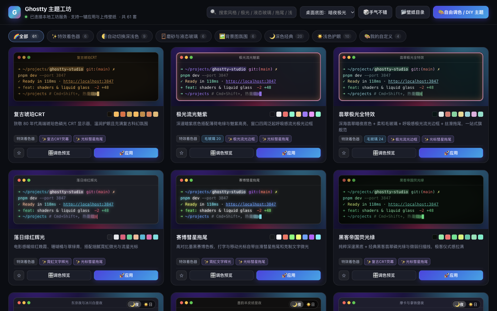
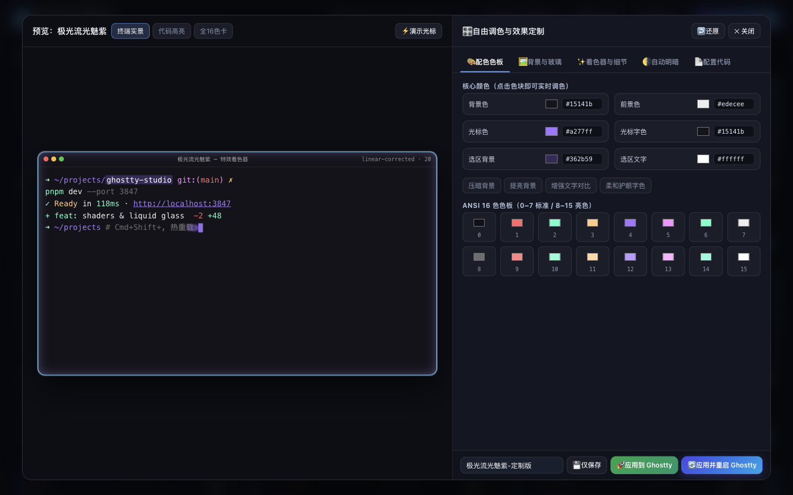
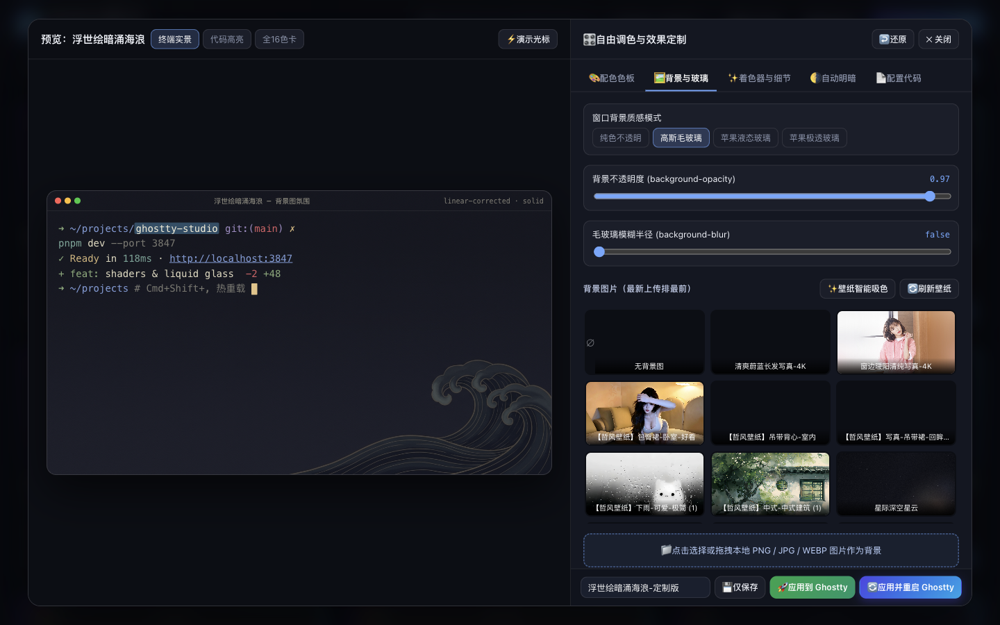
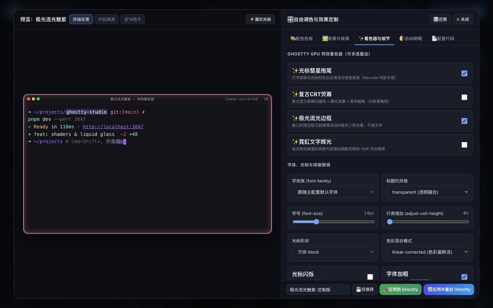

<div align="center">

# Ghostty Theme Studio · Ghostty 主题工坊

> 开箱即用的 **Ghostty 终端可视化主题工坊 + 57 套中文精选配色 + 4 款 GPU 特效着色器 + 自动昼夜切换 + 壁纸智能吸色**，零依赖纯 Node.js 驱动，专为 macOS（支持 macOS 26+ Liquid Glass）深度优化。

<p>
  <a href="https://linux.do" target="_blank">
    
  </a>
  <a href="https://linux.do" target="_blank">
    
  </a>
  
  
  
</p>

</div>

---

## 效果预览

### 1. 主题画廊总览（57+ 套精选 · 特效着色器 / 液态玻璃 / 自动昼夜 / 收藏）


### 2. 自由调色台（实时预览核心色与全 16 色 ANSI 色板）


### 3. 背景壁纸与智能吸色（支持拖拽本地图片 & 壁纸主色自动配对）


### 4. GPU 特效着色器与字体排版（光标彗星拖尾 / 极光边框 / 辉光 / CRT + 字号行高）


---

## 核心特性

- **可视化实时预览与自由调色台（`主题工坊.html`）**：
  - 实时预览全部主题的 macOS 终端效果，支持切换模拟桌面底图、查看自动昼夜对比、⭐ 收藏夹、🎲 手气不错随机抽主题。
  - **全参数自由 DIY**：背景色、前景色、光标、选区、全部 ANSI 0–15 色板、字号、行高（`adjust-cell-height`）、本机已装字体、标题栏风格、透明度、毛玻璃与 macOS 原生液态玻璃（`macos-glass-regular` / `macos-glass-clear`）。
  - **✨ 壁纸智能吸色**：拖入任意本地图片或选中内置壁纸，一键自动分析画面主色调，生成和谐高对比的暗调终端配色。
  - **无损刷新与草稿自动保存**：自带「🔄 刷新壁纸」按钮与切回标签页自动同步，并支持 `localStorage` 草稿自动持久化。
- **4 款 Ghostty 专属 GPU 自定义 GLSL 着色器（`着色器/`）**：
  - `光标彗星拖尾.glsl` — Neovide 同款丝滑流光彗星光标拖尾
  - `极光流光边框.glsl` — 窗口边缘呼吸感极光三色流光描边
  - `霓虹文字辉光.glsl` — 克制级 HDR 荧光微辉
  - `复古CRT荧幕.glsl` — 柔和微扫描线 + 磷光溢出 + 电影暗角（无眩晕畸变）
- **57+ 套中文命名优化主题**：
  - **自动切换深浅色（9 套）**：自动跟随 macOS 外观昼夜变色（含原生苹果液态玻璃昼夜、摩卡与拿铁、玫瑰松晨昏、森系抹茶、墨韵羊皮纸、翡翠极光、落霞月光、绯红朝霞、东京夜与冰川白）。
  - **特效着色器（6 套）** / **磨砂与液态玻璃（6 套）** / **背景图氛围（6 套）** / **深色经典（20 套）** / **浅色护眼（10 套）**。
  - 统一启用 `window-colorspace = display-p3` + `alpha-blending = linear-corrected`，修复 macOS 下终端色彩发灰与内置主题选区/注释看不清的常见问题。
- **自动避坑与安全镜像机制**：
  - 应用主题时自动将壁纸转换为 2560px 标准 PNG 并与着色器/昼夜子配置一同镜像到 `~/.config/ghostty/assets/`，避免 macOS `Documents` 隐私权限（TCC）拦截和渐进 JPEG 无法解码的问题。
  - 自动检测 macOS 液态玻璃（`macos-glass-*`）与背景图片的渲染冲突并提醒切换。

---

## 快速开始

### 1. 克隆仓库
```bash
git clone https://github.com/StackTao/ghostty-theme-studio.git
cd ghostty-theme-studio
```

### 2. 启动可视化主题工坊（推荐）
双击 `启动主题工坊.command`，或在终端执行：
```bash
bash ./启动主题工坊.command
```
浏览器会自动打开 `http://127.0.0.1:3847`，选好或调色完成后点 **「🚀 应用到 Ghostty」**，再切回 Ghostty 按 **`Cmd + Shift + ,`** 热重载生效（更换新壁纸或液态玻璃时可使用「🔄 应用并重启 Ghostty」）。

### 3. 或使用命令行一键切换
```bash
bash ./一键切换主题.sh
```

---

## 目录结构

```text
ghostty-theme-studio/
├── 主题工坊.html          # 可视化预览、调色、吸色与管理前端
├── studio-server.mjs     # 零依赖本地服务（扫描、上传、镜像、校验、应用）
├── 启动主题工坊.command   # macOS 双击启动脚本
├── 一键切换主题.sh        # 终端编号一键切换脚本
├── docs/screenshots/     # README 预览截图
├── 特效着色器/            # 6 套 GLSL 特效主题
├── 自动切换深浅色/        # 9 套随 macOS 自动明暗切换主题
├── 磨砂与液态玻璃/        # 6 套 Liquid Glass 与高斯毛玻璃主题
├── 背景图氛围/            # 6 套带定制背景图主题
├── 深色经典/              # 20 套深度优化深色主题
├── 浅色护眼/              # 10 套柔和护眼浅色主题
├── 我的自定义/            # 工坊保存的自定义主题
├── 着色器/                # 4 个 GLSL 着色器源码
└── 背景图/                # 内置与自定义高清壁纸
```

## 环境要求

- **Ghostty** 1.2+（推荐 **1.4+**，macOS 26+ 支持 `macos-glass-regular` / `macos-glass-clear`）
- **Node.js** 18+（运行本地主题工坊服务，无需 `npm install`）

## 社区与开源协议

<p>
  <a href="https://linux.do" target="_blank">
    
  </a>
</p>

本项目基于 [MIT License](./LICENSE) 开源，欢迎交流分享与 Star ⭐️！
